# extract_direct_targets_v5.py - how it works

## Flowchart (Mermaid)

```mermaid
flowchart TD
    A([Start: python extract_direct_targets_v5.py -i input.csv -o output.csv]) --> B[Read input CSV<br/>needs: Compound, direct or indirect, evidence_pmid]
    B --> C{Row labelled direct?}
    C -- no --> Z1[Skip row]
    C -- yes --> D{Already in output?<br/>resume check}
    D -- yes --> Z1
    D -- no --> E[Queue compound<br/>apply --limit]
    E --> F[Connect to Ollama server<br/>check model exists]
    F --> G[Per compound, parallel --workers]

    G --> H[Fetch abstract from PubMed<br/>evidence PMID]
    H --> I{PMC full text<br/>available?}
    I -- yes --> J[Fetch Results / Discussion from PMC]
    I -- no --> K[Abstract only]
    J --> L
    K --> L{Compound named<br/>in the paper?}
    L -- no --> M[Try next PMID of the compound]
    M --> N{Any paper<br/>mentions it?}
    N -- no --> O[Empty row + PAPER MISMATCH note]
    N -- yes --> P
    L -- yes --> P[Split text into tagged sentences<br/>A1.. abstract, F1.. full text]

    P --> Q[LLM call 1: compound type<br/>kept only if a paper sentence says it]
    P --> R[LLM call 2: find findings<br/>target, evidence tag, interaction type,<br/>role, via_target, pathway]

    R --> S[Validate each finding]
    S --> S1[Target must literally occur in the text<br/>reject phenotypes, cell lines, other drugs, markers]
    S1 --> S2[Evidence = real sentence copied by script<br/>must tie compound to target, not negated]
    S2 --> S3[Check interaction label against sentence<br/>agonist/binding wording, amount vs activity, direction]
    S3 --> T{Role check}

    T -- binds / inhibitor of / metabolized by /<br/>compound inhibits X, AND model said direct --> U[Direct target]
    T -- otherwise --> V[Downstream effect Compound B<br/>or Cause]
    V --> W[Resolve via_target:<br/>named direct target / assumed if only one /<br/>not identified]
    W --> X[Effect type by keyword rules:<br/>production, decreased production,<br/>availability, second messenger, conversion]

    U --> Y[UniProt lookup for direct targets<br/>human reviewed entry]
    Y --> AA[LLM call 3: link target to neurogenesis<br/>exact paper sentence, if any]
    AA --> AB[Write one row to output CSV]
    X --> AB
    O --> AB
    AB --> AC{More compounds?}
    AC -- yes --> G
    AC -- no --> AD([Done: output CSV<br/>Target = direct only, Downstream_* = effects])
```

## Same flow as plain text (works in any viewer)

1. **Read input CSV** - needs columns `Compound`, `direct or indirect`, `evidence_pmid`.
2. **Filter** - keep rows labelled `direct`; skip compounds already in the output (resume); apply `--limit`.
3. **Connect to Ollama** - check the model exists on the server.
4. **For each compound** (parallel, `--workers`):
   1. Fetch the abstract from PubMed for the evidence PMID.
   2. If the paper is in PMC, also fetch the Results / Discussion; otherwise use the abstract only.
   3. If the compound is not named in the paper, try the compound's next PMID. If no paper mentions it, write an empty row with a `PAPER MISMATCH` note.
   4. Split the text into tagged sentences (A1... abstract, F1... full text).
   5. **LLM call 1** - compound type (kept only if a paper sentence says it).
   6. **LLM call 2** - findings: target, evidence tag, interaction type, role, via_target, pathway.
5. **Validate every finding**
   - The target must literally occur in the text; phenotypes, cell lines, other drugs and cell markers are rejected.
   - The evidence is a real sentence copied by the script and must tie the compound to the target (not negated).
   - The interaction label is checked against that sentence (binding wording, amount vs activity, direction).
6. **Role decision (the v5 change)**
   - **Direct target** = the sentence has binding wording ("inhibitor of", "binds to", "metabolized by", "compound inhibits X") **and** the model also said direct.
   - **Anything else = downstream effect (Compound B)** or cause. The code resolves `via_target` (the named direct target, "assumed" if only one exists, or "not identified") and sets an effect type by keyword rules: increased production, decreased production, increased availability, second messenger, conversion.
7. **Direct targets only** - UniProt lookup (human reviewed entry), then **LLM call 3** links the target to neurogenesis with an exact paper sentence, if the paper has one.
8. **Write one row per compound** to the output CSV: `Target` holds direct targets only; `Downstream_Effect`, `Downstream_Effect_Type`, `Downstream_Via_Direct_Target` and `Downstream_Evidence` hold the effects.

## Example of the split

| Paper says | Target (direct) | Downstream effect | Via |
|---|---|---|---|
| Fluoxetine inhibits SERT and increases serotonin | SERT | serotonin | SERT |
| Aspirin inhibits COX-1/2, decreasing prostaglandins | COX-1, COX-2 | prostaglandin | COX-2 |
| Codeine is metabolized by CYP2D6 to morphine | CYP2D6 | morphine | CYP2D6 |
| Compound X raised BDNF mRNA (no binding wording) | *(empty)* | BDNF | Direct target not identified in the paper |
